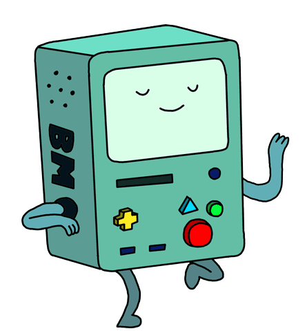

#  </p>

<p>
  
  
  
  
  
  
</p>

```diff
- 🎓 M.Eng. in Computer Technology (2024)
+ 💻 Front-end Engineer (now)

- 🍄 Use code to make a difference in the world
+ 🌴 Build open-source projects to explore creative ideas
```

🧩 <a href="https://lemonadec.cc/archive?tab=portfolio" target="_blank" rel="noopener noreferrer">Things I build</a>
·
✍️ <a href="https://lemonadec.cc/archive" target="_blank" rel="noopener noreferrer">Things I write</a>
