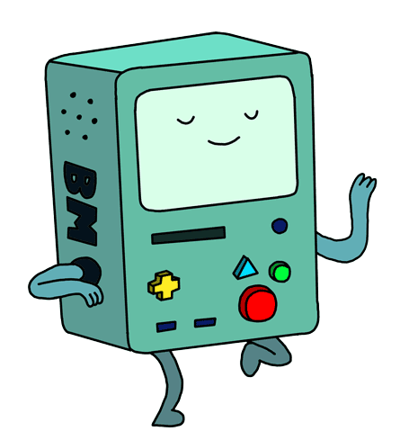

#  

<p>
  
  
  
  
  
  
</p>

```diff
- 🎓 M.Eng. in Computer Technology (2024)
+ 💻 Front-end Engineer (now)

- 🍄 Use code to make a difference in the world
+ 🌴 Build open-source projects to explore creative ideas
```

🧩 <a href="https://lemonadec.cc/archive?tab=portfolio">Things I build</a>
·
✍️ <a href="https://lemonadec.cc/archive">Things I write</a>

<table>
  <tr>
    <td width="50%" valign="top" align="center">
      <a href="https://pr-agent.condevtools.com/"></a><br />
      <a href="https://pr-agent.condevtools.com/">pr-agent</a>&ensp;<a href="https://github.com/condevtools/pr-agent">project</a>
    </td>
    <td width="50%" valign="top" align="center">
      <a href="https://ui.condevtools.com/"></a><br />
      <a href="https://ui.condevtools.com/">condev-ui</a>&ensp;<a href="https://github.com/Lemonadeccc/condev-ui">project</a>
    </td>
  </tr>
  <tr>
    <td width="50%" valign="top" align="center">
      <a href="https://monitor.condevtools.com/"></a><br />
      <a href="https://monitor.condevtools.com/">condev-monitor</a>&ensp;<a href="https://github.com/Lemonadeccc/condev-monitor">project</a>
    </td>
    <td width="50%" valign="top" align="center">
      <a href="https://gen-3-d-assests-web.vercel.app/"></a><br />
      <a href="https://gen-3-d-assests-web.vercel.app/">GEN&nbsp;3D&nbsp;ASSETS</a>&ensp;<a href="https://github.com/Lemonadeccc/GEN-3D-ASSESTS">project</a>
    </td>
  </tr>
</table>
